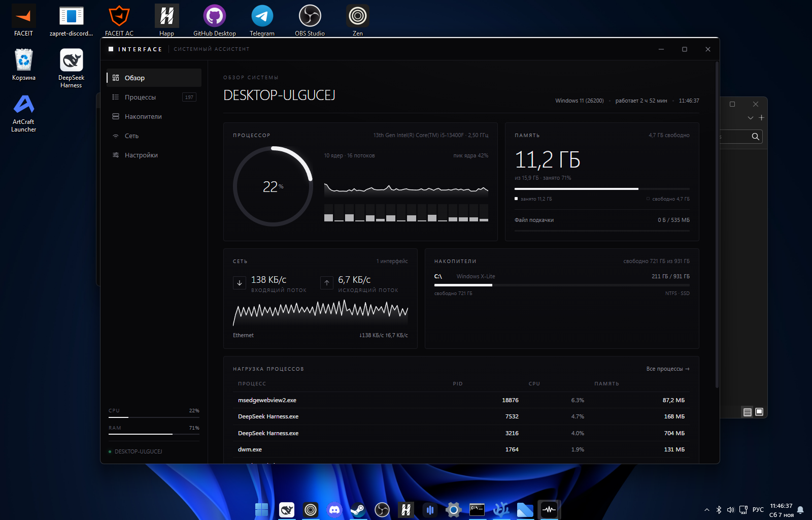
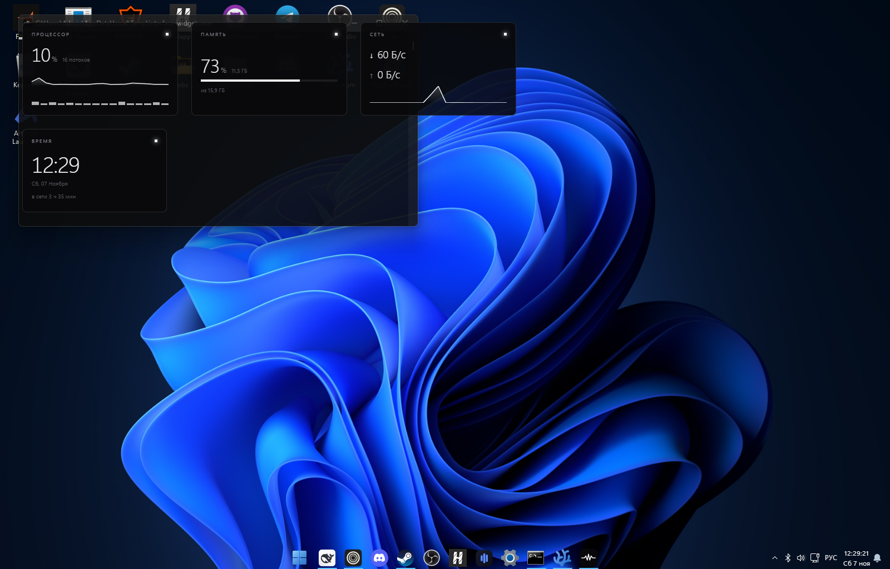
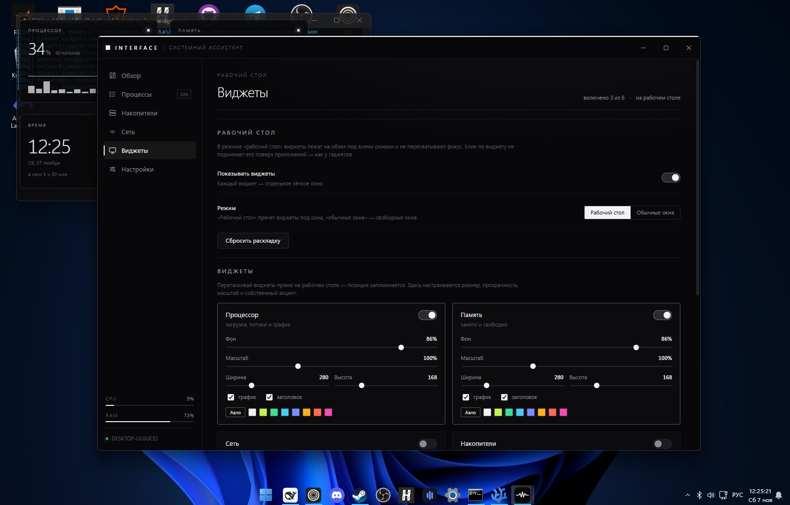

# InterFace

**Скачать:** [InterFace 0.1.0 для Windows](https://github.com/vvixter84-jpg/InterFace/releases/latest) —
установщик NSIS/MSI или портативный exe.

Системный ассистент для Windows: мониторинг нагрузки, встроенный диспетчер задач и
статистика состояния машины. Строгий чёрно-белый интерфейс с выбором акцентного цвета,
живёт в трее и вызывается глобальной клавишей.

Стек: **Tauri 2 + React 18 + TypeScript + Rust**, без сторонних UI-библиотек и без ИИ-моделей —
все метрики снимаются локально через `sysinfo` и WinAPI.



## Что умеет (v0.1)

- **Обзор**: загрузка CPU (общая, по ядрам, история за 10 минут), память и файл подкачки,
  сеть (входящий/исходящий поток), накопители, топ-8 процессов по нагрузке, заряд батареи
  на ноутбуках.
- **Процессы**: полноценный диспетчер задач — поиск по имени и пути, сортировка по CPU,
  памяти, диску, PID и статусу, завершение процесса (с подтверждением), время работы.
  Загрузка процесса считается в процентах от всей машины, как в диспетчере задач Windows.
- **Накопители**: занятое/свободное место по томам, файловая система, съёмные диски.
- **Сеть**: скорости и накопленный трафик по каждому интерфейсу.
- **Трей**: окно скрывается крестиком, а не закрывается; в подсказке иконки — живой
  процент CPU и RAM; меню «Открыть / Свернуть / Выход».
- **Глобальная клавиша** (по умолчанию `Ctrl+Shift+A`) — показать или спрятать окно
  из любого приложения.
- **Оповещения**: если CPU или память дольше нескольких секунд держатся выше 90%,
  появляется уведомление в углу окна (отключается в настройках).
- **Экспорт истории** в CSV — файл кладётся в «Загрузки».
- **Настройки**: акцентный цвет (8 пресетов + свой), хоткей, автозапуск, старт в трее,
  «поверх всех окон», частота опроса (0,5 / 1 / 2 с).
- **Виджеты на рабочем столе**: шесть независимых виджетов — процессор, память, сеть,
  накопители, процессы и часы. В режиме «рабочий стол» они лежат выше обоев и иконок,
  но ниже любых окон, не перехватывают фокус и перетаскиваются мышью. У каждого —
  свой размер, прозрачность, масштаб, акцент, график и заголовок.



## Запуск

Требуется Rust (MSVC-таргет) и Visual Studio Build Tools с компонентом
«C++ build tools» — без `link.exe` проект не соберётся.

```powershell
cd InterFace
pnpm install
pnpm tauri dev
```

Сборка установщика:

```powershell
pnpm tauri build
```

После сборки готовы два установщика:

- `src-tauri/target/release/bundle/nsis/InterFace_0.1.0_x64-setup.exe`
- `src-tauri/target/release/bundle/msi/InterFace_0.1.0_x64_en-US.msi`

Портативная версия — `src-tauri/target/release/interface.exe`: WebView2 берётся из
системы, дополнительных DLL рядом не требуется.

Иконки в `src-tauri/icons` уже сгенерированы. Если меняешь логотип —
поправь `src-tauri/app-icon.svg` и выполни `pnpm icons`.

## Структура

```
InterFace/
├─ docs/screens/            # скриншоты для README
├─ src/                     # React-фронтенд
│  ├─ App.tsx               # каркас, акцент, навигация
│  ├─ components/           # TitleBar, Sidebar, Gauge, Sparkline, Meter, AlertStack
│  ├─ pages/                # Обзор, Процессы, Накопители, Сеть, Виджеты, Настройки
│  ├─ widgets/              # окно виджета: подписка на метрики и шесть видов
│  ├─ hooks/                # useMetrics (подписка на поток), useSettings
│  ├─ lib/                  # обёртка invoke/listen и форматирование
│  └─ styles/global.css     # вся тема: токены, сетка, карточки, виджеты
└─ src-tauri/               # Rust-бэкенд
   ├─ src/metrics.rs        # движок замеров и фоновый поток
   ├─ src/widgets.rs        # окна виджетов и уровень «рабочего стола»
   ├─ src/commands.rs       # команды для окна
   ├─ src/tray.rs           # иконка, меню, подсказка
   ├─ src/settings.rs       # персистентные настройки и раскладка виджетов
   ├─ src/shortcuts.rs      # глобальная клавиша
   └─ src/model.rs          # сериализуемые структуры (camelCase)
```

## Виджеты

Двенадцать видов, каждый — отдельное прозрачное окно без рамки и без кнопки на
панели задач:

| Виджет | Что показывает |
|---|---|
| Процессор | загрузка, потоки, график, ядра |
| Память | процент, занято/всего, шкала |
| Сеть | приём и отдача, график |
| Накопители | место по томам |
| Процессы | топ-3 по CPU |
| Время | часы, дата, аптайм |
| Батарея | заряд, питание, остаток |
| Диски: обмен | скорости чтения и записи по томам |
| Память: топ | три процесса, съевшие больше всего RAM |
| Календарь | месяц с выделенным сегодняшним днём |
| Активность CPU | график, частота, пик ядра |
| Видеокарта | загрузка, VRAM и температура через NVML (NVIDIA) |

Раскладка и оформление хранятся в `settings.json`, позиция сохраняется после
перетаскивания (событие `Moved` → `save_widget_position`).

GPU-виджет работает через NVML, который ставится драйвером NVIDIA: библиотека
подгружается динамически, так что без NVIDIA-карты приложение работает как обычно,
а виджет честно пишет «нет данных».

Режим **«Рабочий стол»** ставит окно сразу над `Progman` через `SetWindowPos` и
добавляет `WS_EX_NOACTIVATE`: виджет выше обоев и иконок, но ниже любых приложений,
клик не поднимает его наверх. После перетаскивания порядок восстанавливается
командой `restore_widgets_order`. Режим **«Обычные окна»** оставляет виджет обычным
окном — удобно, если хочется держать его рядом с другими программами.

Управление — вкладка «Виджеты»: включение, режим, сброс раскладки и настройки
каждого из шести виджетов (размер, прозрачность фона, масштаб, свой акцент,
график, заголовок, прозрачность окна).



## Фон и акцент

Фон приложения — не плоский чёрный, а четыре мягких радиальных пятна акцентного
цвета: верхний левый угол самый яркий, дальше два боковых и нижнее. Полупрозрачные
заголовок и боковая панель подхватывают это свечение, карточки остаются строго
тёмными. Цвет пятен считается из выбранного акцента через `color-mix`-подобную
подстановку в JS (`--glow-strong` / `--glow-soft` / `--glow-faint`), поэтому смена
акцента в настройках мгновенно перекрашивает фон — от белого «света» до лаймового,
цианового или малинового.

Виджеты получают тот же приём в миниатюре: угловое свечение своего акцента и
акцентную линию сверху.

## Производительность

Замеры на 6 включённых виджетах (16-поточный CPU, 16 ГБ):

| Показатель | До | После |
|---|---|---|
| CPU в простое | 3,1% ядра | 0,6% ядра |
| Рабочий набор (дерево процессов) | 901 МБ | 813 МБ |

Что сделано:

- окна виджетов по умолчанию **непрозрачные** — DWM не пересобирает композицию
  на каждый кадр; стекло включается галочкой «прозрачность окна» для конкретного
  виджета;
- список процессов перечисляется раз в 2 секунды, а не каждый тик (обход ~200
  процессов — самая дорогая часть замера);
- `Networks` переиспользуется между замерами вместо создания заново;
- `disk_usage()` вызывается один раз на процесс, а не дважды;
- в снимок для UI не попадают полные пути процессов (их сериализация была самой
  объёмной частью события);
- окно и размер применяются только при реальном изменении — меньше событий
  `Moved` и лишних сохранений;
- история графиков виджетов сокращена со 120 до 60 точек;
- таблица процессов ограничена 220 строками вместо 400.

Остальной расход памяти — это WebView2: примерно 100–120 МБ на каждое окно
(главное + виджеты). Меньше виджетов — меньше памяти; полностью убрать этот
расход можно только отказом от WebView2 в пользу нативной отрисовки.

## Автоскрытие в играх

Виджеты не нужны, пока игра занимает весь экран, — и не должны тратить ресурсы.
Автоскрытие включено по умолчанию и работает так:

1. Раз в 1,2 с проверяется `SHQueryUserNotificationState` (оболочка сама сообщает
   о D3D-полноэкранном режиме и презентациях) и активное окно: если оно другого
   процесса и покрывает свой монитор — это borderless-игра или видео.
2. При входе в полноэкранный режим окна виджетов **закрываются** (не прячутся):
   `WebView2` освобождает память, а сэмплер встаёт на паузу — ни опроса системы,
   ни рассылки событий.
3. При выходе окна пересоздаются из сохранённой раскладки.

Замер на этой машине (Counter-Strike 2 на весь экран, второй монитор свободен):

| Состояние | Процессов | Память | CPU за 15 с |
|---|---|---|---|
| Игра на весь экран (2 виджета «закрыты») | 7 | 389 МБ | 0,00 с |
| Виджеты активны (2 шт.) | 9 | 564 МБ | 0,09 с |

Ручное управление: пункты «Скрыть виджеты» / «Показать виджеты» в меню трея и
кнопка на вкладке «Виджеты». Ручное скрытие тоже закрывает окна и освобождает
память.

## Как это работает

1. При старте `metrics::Engine::new()` делает два замера CPU с паузой `MINIMUM_CPU_UPDATE_INTERVAL` —
   иначе первое значение всегда было бы нулевым.
2. Фоновый поток раз в `sample_ms` обновляет `System`, `Disks`, `Networks` и складывает
   снимок в `Arc<Mutex<Engine>>`, затем отправляет его в окно событием `interface:metrics`.
3. Фронтенд подписан на событие: последний снимок идёт в карточки, а из него же строится
   кольцевой буфер истории (300 точек) для графиков.
4. Тяжёлые операции (полный список процессов, kill, экспорт) — отдельные команды,
   которые читают то же состояние, не запуская второй опрос.
5. Скорости сети считаются по приращению `total_received()/total_transmitted()` между
   замерами, поэтому не зависят от внутренних счётчиков адаптера.
6. Перед созданием окон приложение заранее готовит `%LOCALAPPDATA%\com.interface.monitor`:
   WebView2 не всегда может создать профиль сам, а без каталога окно не появится.

Настройки лежат в `%APPDATA%\com.interface.monitor\settings.json`.

Другие экраны: [процессы](docs/screens/processes.png), [накопители](docs/screens/storage.png),
[настройки](docs/screens/settings.png).

## Что дальше

- Мини-виджет поверх окон (компактная полоса с CPU/RAM/сетью).
- Уведомления Windows через `tauri-plugin-notification` вместо внутриоконных.
- История на диск (SQLite) вместо памяти — графики за сутки.
- Автозапуск проверен только на собранной версии: в dev-режиме регистрируется путь
  к отладочному exe.
- Завершение системных процессов требует прав администратора — сейчас возвращается
  понятная ошибка.
